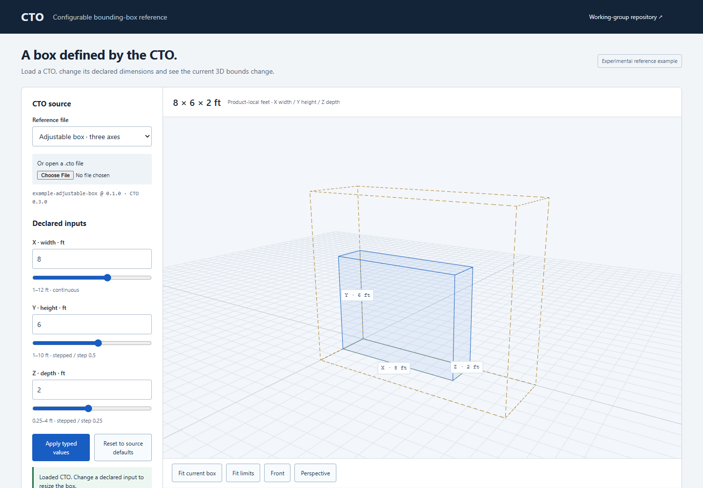

# Configurable CTO bounding box — non-normative reference example

This deliberately small example shows **a bounding box, not a product model**.
Load an element CTO, read its declared dimensional inputs, change a value, and
see its literal current 3D bounds change. The camera does not automatically
rescale after a change, so resizing is visibly apparent against the fixed origin,
grid and separately drawn input-limit envelope.



[Watch the short actual-box walkthrough](walkthrough.mp4). It is a silent screen
recording of the same example: three-axis resizing, invalid-step refusal and a
configured CTO download/reopen. No native-model or product animation is used.

Related discussion: [issue #4](https://github.com/configurator-file-type/cto-specification/issues/4). This illustrates the
experimental parameter/opening profile at CTO commit
`271b221079d6d90f98a5f064ca2e5ef2138cb5cb`; that editorial-branch merge is not
adoption into the released 0.2 standard or `main`'s living specification.
No specification, schema, frozen release or governance file is changed.

## Run

From the repository root, with Node.js 22 or newer:

```sh
node examples/configurable-bounding-box/serve.mjs
```

Open the printed loopback URL. No dependency installation, network CDN, account
or external API is required. The vendored Three.js runtime is MIT-licensed; see
`vendor/THREE-LICENSE.txt`. This folder is portable static content and may also be
served by any ordinary local HTTP server. Opening directly as a `file://` URL is
not supported by browser module loading. `PORT` changes the local server port.

```sh
node --test examples/configurable-bounding-box/test.mjs
```

## Try the exact loop

1. Open `adjustable-box.cto`. X/width is continuous; Y/height and Z/depth are
   stepped. All limits/defaults/steps and numeric bindings are in that CTO.
2. Move a slider, or type values and apply. The accepted box changes in product-
   local feet. An invalid value is refused; it is not silently snapped or clamped.
3. Toggle the dashed input-limit envelope independently of the current box.
   This overlay never replaces literal `geometry.bounding_box` with a range.
4. Optionally load `box-with-void.cto`: one source-defined rectangular void has
   fixed size/offsets and explicit containment rules. It is shown only as a void
   envelope, not manufactured geometry. `offset_z_ft` means bottom/Y offset in
   the pinned draft despite its legacy name; Z remains through-depth.
5. Download the configured snapshot and reopen it. Version, current extents and
   source-declared void survive. It is fixed, because the resolution step removes
   the parameter block. Download the original editable source separately when
   you need the rules and another configurable session.

## Reuse and scope

`core.mjs` resolves the explicitly bounded draft expression/binding profile with
no host-language evaluation. Protected identity/interface fields cannot be
rebound. `opening-geometry.mjs` is an optional reader of the existing pinned-draft
fields, not a new schema. `webgl.mjs` draws exact box dimensions, not inflated
geometry for visual outlining. `viewer.mjs` emits `ctoboxchange` with the resolved
CTO, so a separate Registry or configurator can consume the same output. This
standalone example does not itself integrate a production Registry/house builder.

The fixtures are synthetic visualization data. `wall_panel` is only an existing
schema category carrier; no new `box` category is proposed and no physical product
is represented. There are no manufacturer-native models, fabrication details,
private-source values, brand/catalog logic, prices, accounts or hosted services.
This is neither an independent-implementation conformance claim nor engineering,
fabrication, CIS or Registry-publication approval. Fixed 0.2 files do not acquire
draft opening semantics implicitly. Arbitrary topology/native regeneration are
outside this example.

Source code is Apache-2.0 under the repository policy; example data follows the
repository's specification-example license. No external application is an
authoritative source for this proposed example: its code and fixtures live here.
